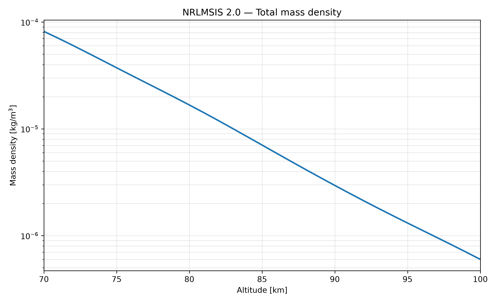
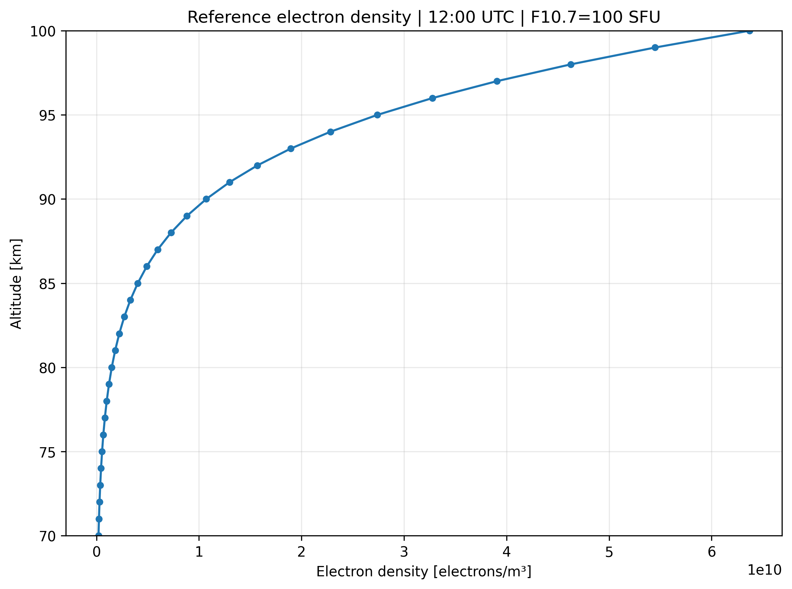
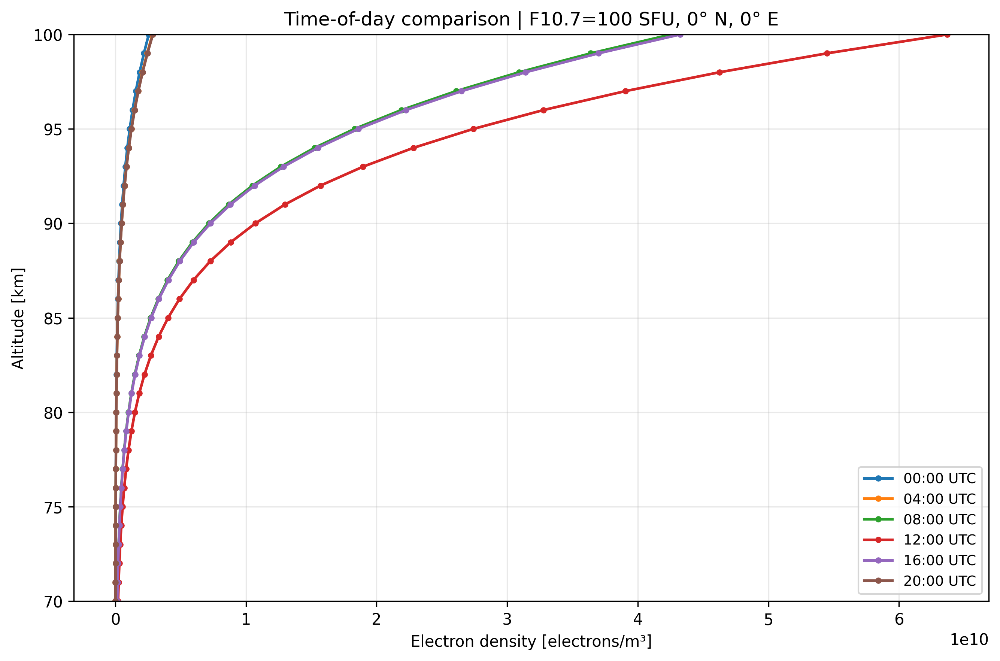
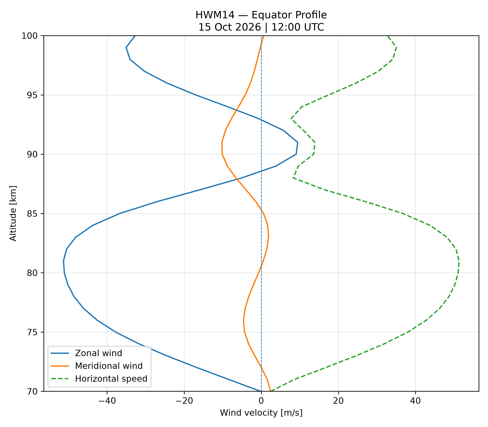
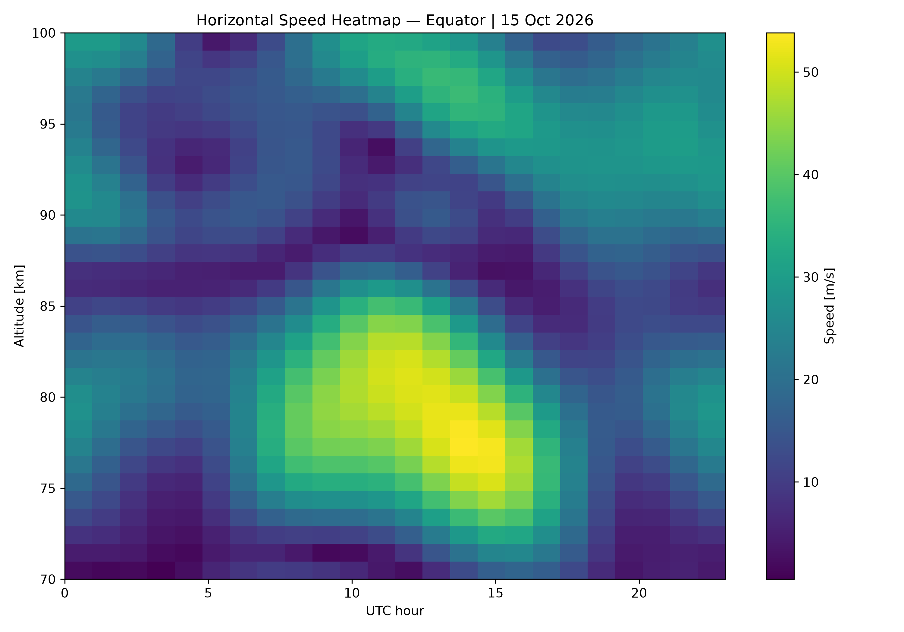

> **Source:** drive-2026-10-20, `Environment/Models/Launch_Systems_Environmental_Briefing.docx` | **Author:** python-docx (mod. Amariutei Mara) | **Date:** 2026-10-19 17:40:00 | *converted with docling  - generated, do not edit*

# Environmental data collection for our sounding-rocket mission

## 1  What are we trying to achieve?

We are studying an air-launched sounding rocket carrying scientific instruments to the upper atmosphere. Our current mission brief targets measurements between 70 and 100 km, an apogee of roughly 110–125 km, a payload up to 250 kg, a release mass up to 1,750 kg, and recovery of the science payload. These are design requirements, not outcomes already demonstrated.

Our first question was: what atmospheric conditions should the rocket and its instruments be prepared for? We explored this using three complementary empirical/reference models, all processed and plotted in Python.

### The three investigations at a glance

| Model / app   | What it describes                                    | Why we need it                                               |
|---------------|------------------------------------------------------|--------------------------------------------------------------|
| NRLMSIS 2.0   | Neutral atmospheric gases, temperature, mass density | Environmental inputs for aerodynamic and thermal assessment  |
| IRI / PyIRI   | Free-electron density in the ionosphere              | Scientific measurement environment and timing                |
| HWM14         | Horizontal wind components                           | Relative wind, trajectory disturbances and recovery planning |

### What we can claim at this stage

We have collected preliminary atmospheric-model results over the scientific observation region (70–100 km), and explored some variations with time, location and solar activity. We have NOT yet built a complete trajectory simulation or selected final mission conditions.

### Suggested informal introduction

“Before choosing the actual rocket configuration, we wanted to understand the atmospheric conditions where we plan to make measurements. We used three models because each one describes something different: the neutral air, the free electrons, and the horizontal winds. These results should become environmental inputs for the next design steps.”

## 2  NRLMSIS 2.0 — the neutral atmosphere

Tool used: NRLMSIS 2.0, through a Python script (mesosphere.py). We calculated atmospheric species, number density, composition, temperature and total mass density for altitudes from 70 to 100 km.

Figure 1. Modelled total mass density versus altitude — original team plot.

Figure 2. Atmospheric species composition over the same altitude interval — original team plot.

### What did we learn?

Total mass density decreases strongly with altitude. The dominant neutral constituents include N₂ and O₂, with contributions from argon and atomic oxygen. In this reference case, temperature changes by approximately 16 K across the selected band.

### Connection with the assignment

Density is needed to estimate aerodynamic drag: D = ½ ρ V² Cᴅ A. Temperature and composition help describe the operating environment and support later thermal and instrument studies. NRLMSIS supplies environmental inputs; it does not calculate drag by itself. The rocket also flies below 70 km, so a complete trajectory requires an extended atmospheric profile.

How to say it: “NRLMSIS tells us what the air is made of and how dense and warm it is. This is useful because drag depends on air density, so later we can combine these profiles with a rocket trajectory and geometry.”

## 3  IRI / PyIRI — the ionospheric environment

Tool used: the Python PyIRI implementation of the International Reference Ionosphere, with NumPy and Matplotlib. Reference case: 70–100 km, 1 km steps, equator (0° N, 0° E), 21 June 2025, 12:00 UTC, assumed F10.7 = 100 SFU.

Figure 3. Electron density in the reference scenario — original team plot.

Figure 4. How predicted electron density changes with time of day — original team plot.

### What did we learn?

For the reference scenario, the model predicts about 2.03 × 10⁸ electrons/m³ at 70 km and 6.37 × 10¹⁰ electrons/m³ at 100 km. Day/night variations are pronounced; the solar-activity and geographical studies show that environmental conditions depend on when and where the mission flies.

### Connection with the assignment

This is directly relevant if our scientific instruments measure ionospheric or related upper-atmospheric properties. PyIRI gives us a reference prediction against which measured data could be compared. It also helps us discuss launch time and site. The F10.7 input is an illustrative assumption; predictions near 70–90 km need careful validation for a real mission.

How to say it: “Unlike NRLMSIS, PyIRI describes free electrons rather than neutral air. We see that electron density can be very different during the day and at night, so we should choose our measurement objectives and launch conditions together.”

## 4  HWM14 — how the upper-atmospheric wind moves

Tool used: Horizontal Wind Model 2014 (HWM14), through Python. The reference profile was generated for the equator (0° latitude, 0° longitude), 15 October 2026 at 12:00 UTC, with quiet geomagnetic conditions. We studied zonal (east–west) and meridional (north–south) winds, plus variation with altitude, time, season and geography.

Figure 5. Reference zonal and meridional winds by altitude — original team plot.

Figure 6. How horizontal wind speed varies across altitude and time — original team plot.

### What did we learn?

In the reference profile, zonal wind reaches about −51 m/s near 81 km (westward under the model sign convention). The meridional component is smaller, approximately −10 to +2 m/s. The additional plots show wind changes with altitude, time, season and geographical position.

### Connection with the assignment

Wind modifies the velocity of the rocket relative to the air, which can affect aerodynamic loading, trajectory and recovery drift. HWM14 gives wind input data, not a direct prediction of landing point or aerodynamic force. Lower-atmosphere winds and an integrated flight simulation are still required.

How to say it: “HWM14 tells us how the air is moving horizontally. These winds matter because the vehicle sees airflow relative to its own motion. We can use this as an input when we analyse flight stability, trajectory deviation and payload recovery.”

## 5  How the models fit together

They describe three different aspects of the same atmosphere. For design, the useful next step is to choose one consistent scenario (location, season/date, local time and activity assumptions) and assemble environmental profiles for a trajectory model and a scientific instrument concept.

| Mission question                                 | Our source   | What remains                                               |
|--------------------------------------------------|--------------|------------------------------------------------------------|
| How much neutral air / which species?            | NRLMSIS 2.0  | Extend below 70 km; add mission-consistent conditions      |
| What electron density might instruments observe? | PyIRI        | Specify measured quantity, accuracy and validation         |
| How does horizontal air motion vary?             | HWM14        | Add lower-altitude winds; use in trajectory/recovery model |

### 

### Which assignment areas are covered?

| Assignment workstream                                           | Status after this investigation                     |
|-----------------------------------------------------------------|-----------------------------------------------------|
| Atmospheric environmental research, 70–100 km                   | Covered at preliminary model level                  |
| Neutral atmosphere / density / temperature                      | Model data and plots collected                      |
| Ionospheric science environment                                 | Model data and parameter variations collected       |
| Horizontal wind environment                                     | Model data and multiple sensitivity plots collected |
| Mission location, launch time, full environmental profile       | Partly explored; not finalized                      |
| Science payload definition, trajectory, rocket sizing, recovery | Still to be designed and analysed                   |

### Important limitations

- The models are predictions, not in-flight measurements or proof of mission feasibility.
- Our IRI and HWM14 reference dates differ; they should not be treated as one synchronized scenario.
- Most model work focuses on 70–100 km, while the vehicle must also travel through the lower atmosphere.
- The scientific payload must be defined before deciding which model variables are mission requirements rather than simply useful background.

### Next decisions

- Where and when should the air launch happen?
- Which physical quantity or quantities will the payload actually measure?
- What common input conditions should we use for all models?
- How will we incorporate atmospheric profiles into trajectory and recovery calculations?

So far, we have built a first picture of the environment in our measurement region: neutral air from NRLMSIS, ionization from PyIRI, and horizontal winds from HWM14. That covers the atmospheric data-collection part of the assignment at a preliminary level. Our next task is to define one realistic mission scenario and turn these datasets into actual design inputs.
