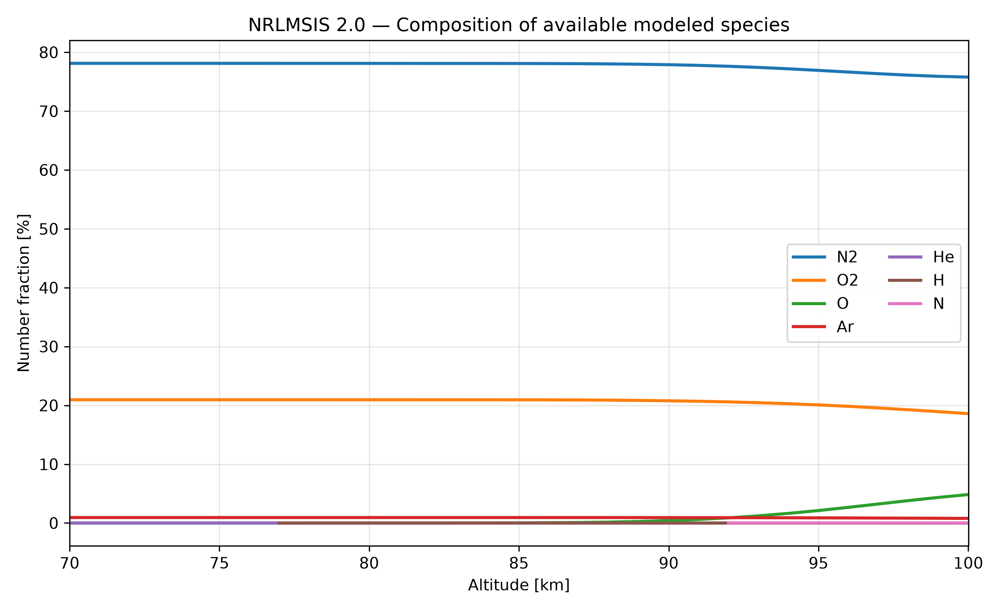
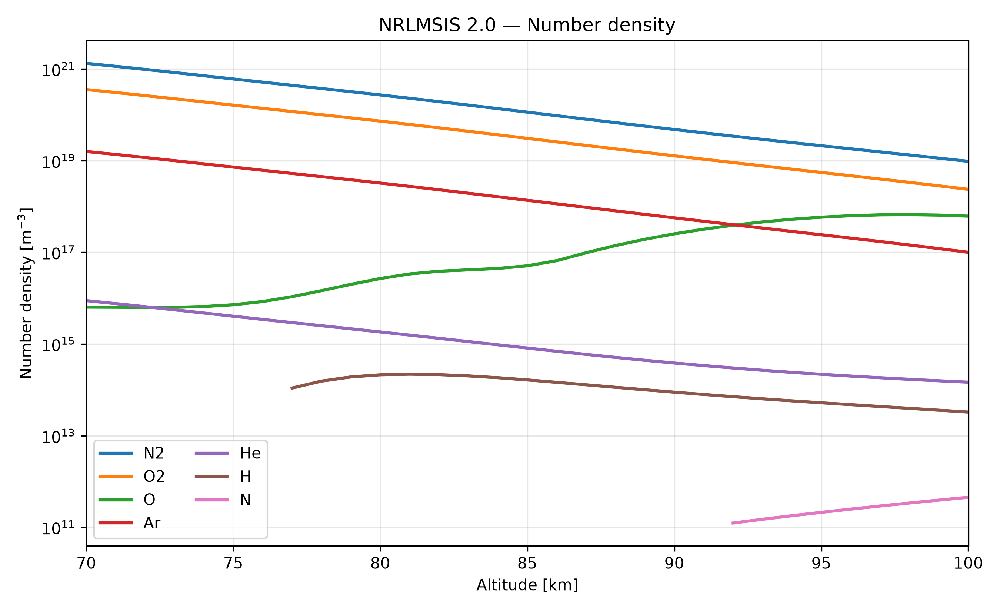
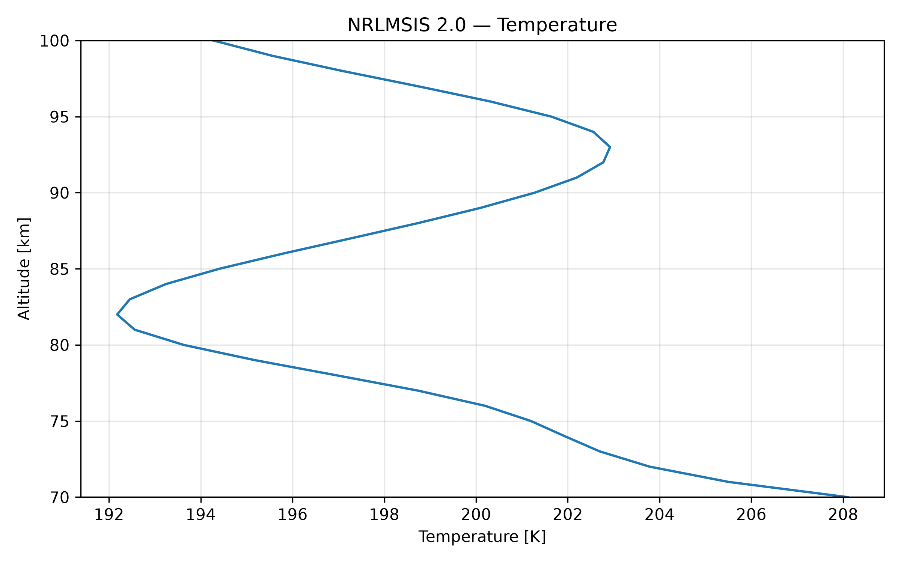
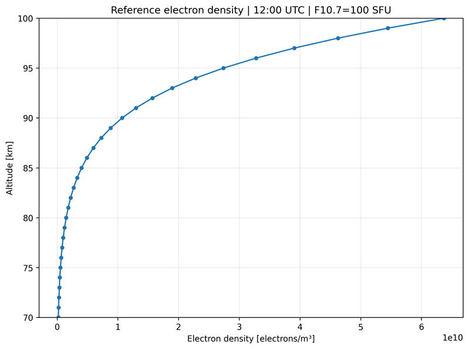
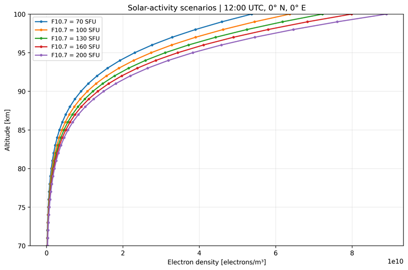
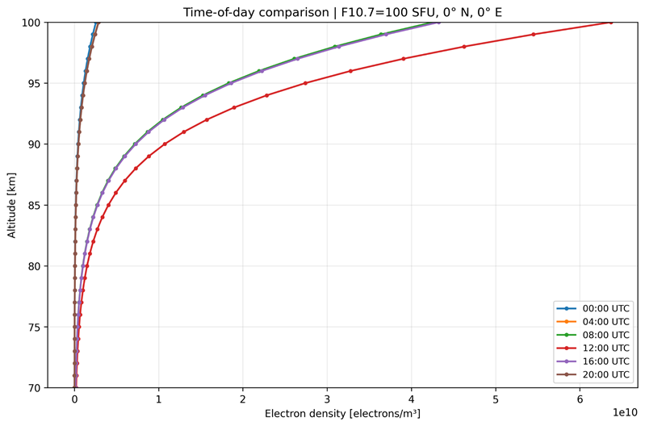
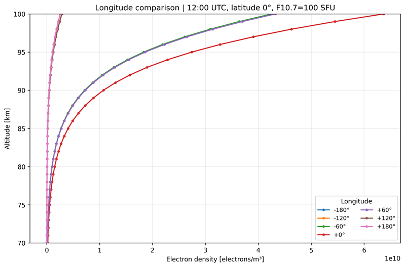
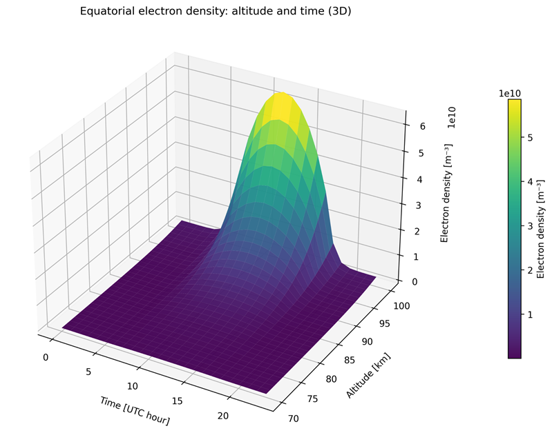
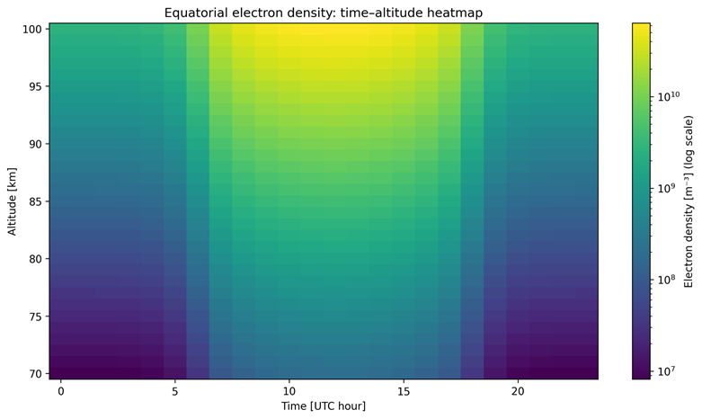
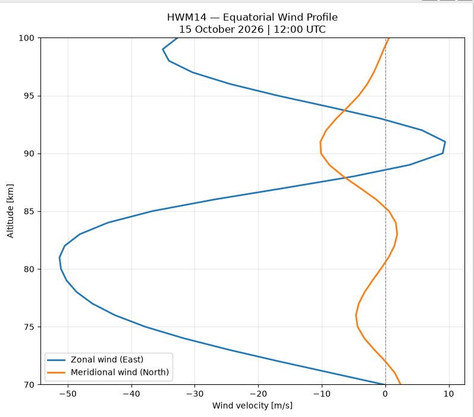

> **Source:** drive-2026-10-20, `Environment/Models/Model Findings.docx` | **Author:** João Tomas Neves Murias da Silva | **Date:** 2026-10-15 21:51:14 | *converted with docling  - generated, do not edit*

**Environment Analysis**

***Atmospheric Composition:***

Using the Naval Research Laboratory Mass Spectrometer and Incoherent Scatter Radar (NRLMSIS 2.0) Model we were able to obtain the following plots

Total Mass Density:

Species Composition (Number Fraction):

Species Composition (Number Density):

Temperature:

**Conclusions:**

The most prevalent species in the orbital range from 70km to 100km are: Molecular Oxygen, Molecular Nitrogen, Argon, Atomic Oxygen. Less prominent: Atomic Helium, Atomic Hydrogen and Atomic Nitrogen.

The temperature variation in this region is fairly small (delta T = 16K).

The total mass density decreases exponentially with altitude, as expected.

***Ionospheric electron density: 70–100 km***

We used Python with the PyIRI model to estimate the number of free electrons in the ionosphere before choosing a rocket launch location. PyIRI produced the model values, while NumPy and Matplotlib were used to organize the data and create the plots. These results are model estimates, not measurements.

Reference settings: altitude 70–100 km in 1 km steps; latitude 0° and longitude 0° unless otherwise stated; reference time 12:00 UTC; assumed F10.7 solar flux of 100 SFU. Additional plots change solar activity, UTC time, or longitude one at a time. The F10.7 values are test scenarios, not verified observations for this date.

**1. Reference profile — one time and location**

**Figure 1. Reference electron-density profile at 12:00 UTC, 0° latitude, 0° longitude, F10.7 = 100 SFU.**

This is our starting case. The vertical axis is altitude and the horizontal axis is electron density (electrons per cubic metre). The curve moves to the right as altitude increases: the model predicts more free electrons at higher altitudes. At 70 km, the density is 2.034 × 10⁸ m⁻³; at 90 km, it is 1.0717 × 10¹⁰ m⁻³; and at 100 km, it reaches 6.3704 × 10¹⁰ m⁻³. We use this curve as a reference for the later comparisons.

**2. Different levels of solar activity**

**Figure 2. Electron density for five assumed F10.7 solar flux levels, with other inputs unchanged.**

The five lines show what happens when we change only the assumed solar activity input, from 70 to 200 SFU. Higher F10.7 values give higher predicted electron densities, especially closer to 100 km. At lower altitudes the curves sit much closer together. This tells us that the result is more sensitive to the solar activity input near the upper end of the selected altitude range. These are controlled model scenarios, not five observations on the same date.

**3. Different times of day**

**Figure 3. Electron-density profiles at six UTC times, using F10.7 = 100 SFU and the same location.**

The daytime curves extend further right, meaning more free electrons, while the night-time curves stay near the left side of the graph. At 100 km, the 12:00 UTC curve is clearly higher than the midnight and early-morning curves. This is consistent with stronger solar ionization in daylight and reduced ionization after sunset. At longitude 0°, UTC is close to local mean solar time. The values at low altitudes should still be treated cautiously.

**4. Different longitudes along the equator**

**Figure 4. Electron density at selected equatorial longitudes, all evaluated at 12:00 UTC.**

Here the latitude remains 0°, while longitude changes. Some curves nearly overlap because some locations have similar model conditions at this hour. Longitude 0° has relatively high density at 12:00 UTC, whereas positions on the opposite side of Earth have much lower values. The main reason is that the same UTC hour corresponds to different local times around the world. Therefore, this plot does not by itself show which launch site is better. For a fair site comparison we should also compare locations at the same local solar time.

## 5. Combined altitude–time view — 3D surface

**Figure 5. The same altitude–time model results shown as a 3D surface; surface height and color represent electron density.**

This is another way to read the data from Figure 1. The surface rises most strongly near 100 km during the middle of the day and becomes low at night. The shape makes the combined influence of altitude and time easier to see. This is not a picture of the physical shape of the atmosphere: the vertical height of the surface represents electron density, not the height above Earth.

**6. Electron density across altitude and time — heatmap**

**Figure 6. Electron density versus altitude and UTC hour, shown on a logarithmic color scale.**

The colors show how electron density changes during the day. Dark purple and blue indicate fewer electrons, while green and yellow indicate more. Density is generally higher near 100 km than near 70 km. The largest values occur during daylight, around the middle of the UTC day at longitude 0°. This graph is useful because it shows altitude and time together. The logarithmic color scale makes both small and large values visible.

## Conclusion and limitations

Our first calculations show two clear patterns in PyIRI: electron density generally increases from 70 to 100 km, and it changes strongly between day and night. The solar-activity scenarios also produce different results. These plots are a useful first comparison before choosing a launch site or time.

Important limits: F10.7 = 100 SFU is assumed, not checked against historical measurements; model values in the lower ionosphere, particularly near 70–90 km, need independent validation. PyIRI estimates electron density here; these plots do not describe neutral atmospheric density or aerodynamic drag.

***Wind Profile:***

The horizontal wind environment between 70km and 100km was investigated using the Horizontal Wind Model 2014 (HWM 14). Simulation performed at the equator (0º lat. 0º long), for 15 October 2026 at 12:00 UTC, assuming quiet geomagnetic conditions (Ap = 4).

Strong altitude dependence of the zonal wind component, with mainly westward winds, reaching a minimum of –51m/s near 81km altitude, and a maximum of +9m/s reached at 91km.

Meridional wind variation is quite smaller, ranging from –10m/s to +2m/s.

